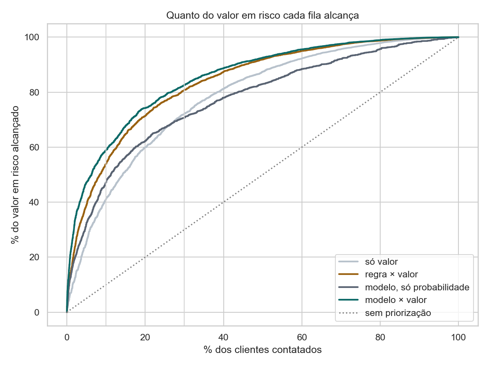

# Priorização de cobrança por risco de atraso

Numa carteira de crédito parcelado ao consumidor, quanto do caixa previsto está em risco, e quem a equipe de cobrança deve procurar primeiro?

O projeto responde a essas duas perguntas com SQL Server, Python e Power BI, usando o histórico de pagamento parcela a parcela da base pública Home Credit. O resultado é uma fila de cobrança com quatro ações (renegociação, contato, lembrete e monitoramento), avaliada contra o que de fato aconteceu com cada cliente.

**Status:** análise e modelo concluídos; painel do Power BI em construção.

## Principais resultados

- **O problema:** de 156.333 clientes com 41,1 bilhões previstos para vencer no período analisado, 2.621 (1,68%) atrasaram mais de 15 dias. Eles respondem por 745,6 milhões, 1,8% do valor.
- **O modelo:** os 10% de clientes com maior risco concentram 44,7% dos casos de atraso, contra 38,5% da melhor regra manual (ordenar pelo atraso recente).
- **A fila de cobrança:** ordenando pelo valor esperado em risco (probabilidade × valor a receber), contatar 10% da carteira alcança 58,9% do dinheiro que de fato ficou em risco. Com 30% da carteira, chega a 82,6%.
- **De onde vem o ganho:** sem modelo, multiplicar a regra manual pelo valor já alcançaria 53,9% com 10% da carteira. O modelo acrescenta 5,0 pontos, e 8,2 pontos nos 5% do topo da fila, onde a equipe começa.



## Como o problema foi montado

A base não tem datas de calendário: tudo é contado em dias antes de um novo pedido de crédito do cliente (dia 0). Para simular a situação real da cobrança, o projeto "volta no tempo" até uma data de corte:

| Período | Dias | Para que serve |
| --- | --- | --- |
| Histórico | antes de -365 | O que o modelo pode ver: como o cliente pagou até o corte |
| Previsão | de -365 a -15 | O que o modelo tenta prever: se o cliente vai atrasar mais de 15 dias |
| Fora da análise | de -15 a 0 | Parcelas recentes demais para observar um atraso de 15 dias |

Três cuidados para o modelo não "ver o futuro":

- uma parcela vencida antes do corte e paga depois dele conta, no histórico, como em aberto no dia do corte;
- o período de previsão só inclui contratos que já existiam no corte, porque a pergunta é "quem da carteira atual vai atrasar";
- os dados cadastrais (renda, idade, emprego) são do pedido atual, posteriores ao corte, e por isso ficam fora do modelo;
- o valor a receber de cada cliente é o previsto no dia do corte, calculado pelas condições dos contratos (primeiro vencimento, prazo e valor da parcela), e não o que acabou sendo cobrado.

Cada escolha está registrada, com as alternativas consideradas, em [`docs/decisoes.md`](docs/decisoes.md).

## Modelo

Foram comparadas uma regra simples, uma regressão logística e um gradient boosting, cada modelo com dois conjuntos de variáveis de comportamento: só o histórico de pagamento, e o histórico mais a carteira no dia do corte (parcelas vencidas e ainda em aberto, contratos ativos, saldo a vencer, tempo desde o último contrato). A base é desbalanceada, então a avaliação olha o topo da lista, não a acurácia. A escolha foi feita por validação cruzada no treino; o teste (30% dos clientes) só mede o resultado.

| Abordagem (teste) | AUC | Precisão média | Casos no top 10% | Valor no top 10% |
| --- | --- | --- | --- | --- |
| Regra simples (% de atraso recente) | 0,714 | 0,062 | 38,5% | 36,9% |
| Regressão logística (histórico) | 0,737 | 0,093 | 43,3% | 39,9% |
| Regressão logística (histórico + carteira) | 0,750 | 0,107 | 44,9% | 45,4% |
| Gradient boosting (histórico) | 0,724 | 0,099 | 43,3% | 41,2% |
| **Gradient boosting (histórico + carteira, escolhido)** | **0,738** | **0,118** | **44,7%** | **46,2%** |

As variáveis de carteira melhoraram os dois modelos: na validação cruzada, a precisão média subiu de 0,110 para 0,124 na regressão logística e de 0,109 para 0,134 no gradient boosting, que foi o escolhido. No teste, a regressão logística com as mesmas variáveis ficou muito próxima; a escolha foi mantida porque trocar de modelo depois de ver o teste seria usar o teste para escolher. Os sinais mais fortes são o maior atraso nos 6 meses antes do corte e as parcelas vencidas e ainda em aberto no dia do corte.

As probabilidades foram calibradas (calibração isotônica): no decil de maior risco, a probabilidade média prevista é de 7,9%, contra 7,4% de atraso real.

**Sensibilidade:** com o critério de atraso acima de 30 dias no lugar de 15, o mesmo modelo alcança 53,3% dos casos no top 10% (AUC de 0,792). A conclusão não depende do limite escolhido.

**Cadastro:** renda, idade e emprego ficaram fora do modelo por serem posteriores ao corte e por não serem um critério justo de cobrança. Na validação cruzada, incluí-los subiria a AUC de 0,766 para 0,773 e os casos no top 10% de 47,4% para 47,7%. O custo da escolha é pequeno.

## Régua de cobrança

Primeiro, a comparação das filas, para separar o efeito de olhar o valor do efeito do modelo:

| Fila (% do valor em risco alcançado) | 5% da carteira | 10% | 30% |
| --- | --- | --- | --- |
| Só valor a receber | 25,5% | 41,1% | 72,1% |
| Regra × valor | 39,0% | 53,9% | 80,9% |
| Modelo, só probabilidade | 32,4% | 47,3% | 70,7% |
| **Modelo × valor (escolhida)** | **47,2%** | **58,9%** | **82,6%** |

A régua divide a fila do modelo × valor em quatro ações:

| Ação | Quem recebe | Clientes | Taxa de atraso real | Valor em risco real coberto |
| --- | --- | --- | --- | --- |
| Renegociação | Topo da fila (10%) com atraso acima de 30 dias nos 6 meses antes do corte | 547 | 29,4% | 5,9% |
| Contato | Restante dos 10% do topo | 15.086 | 5,2% | 53,0% |
| Lembrete | Os 20% seguintes | 31.266 | 1,8% | 23,7% |
| Monitoramento | Os 70% restantes | 109.434 | 1,0% | 17,4% |

Os cortes de 10% e 30% representam uma equipe que atende pessoalmente 1 em cada 10 clientes e manda mensagens automáticas para mais 2 em cada 10. Na prática, seriam ajustados à capacidade real. O valor esperado em risco estimado pelo modelo (696,9 milhões) ficou 6,5% abaixo do valor que de fato ficou em risco (745,6 milhões); para planejar caixa, deve ser tratado como um piso.

## Limitações

- **Todo cliente fez um novo pedido no dia 0.** Quem volta a pedir crédito tende a estar em dia, o que provavelmente reduz a taxa de atraso observada.
- **Cadastro posterior ao corte.** Por isso ele fica fora do modelo e aparece só na análise exploratória e no painel.
- **Calendário previsto aproximado.** O valor previsto no corte considera parcelas a cada 30 dias, pelas condições de cada contrato. Na conferência, o total previsto ficou 1,1% abaixo do cobrado de fato, e 80 clientes ficaram sem valor previsto.
- **Parcelas não pagas quase não aparecem na base** (1.152 parcelas, menos de 0,01% do total). Na prática, o alvo mede "pagou com mais de 15 dias de atraso", e não "parou de pagar".
- **Desempenho moderado** (AUC de 0,74), coerente com um modelo que só conhece o histórico de pagamento na própria empresa, sem dados de bureau de crédito.

## Estrutura

```
sql/                  banco collections_risk, em três camadas (raw, staging, analytics)
  exploration/        consultas que embasaram as regras, com os resultados comentados
src/
  db.py               conexão com o SQL Server, leitura e gravação de tabelas
  load_raw.py         carga dos CSVs na camada raw
  eda.py              funções da análise exploratória
  modeling.py         variáveis do modelo e métricas de captura
notebooks/
  01_exploracao       quem atrasa e o que o histórico diz sobre isso
  02_modelo           comparação, avaliação, calibração e scores de toda a carteira
  03_regua_de_cobranca  fila por valor esperado e ação de cada cliente
run_pipeline.py       executa o projeto inteiro em ordem: scripts SQL, carga e notebooks
docs/
  decisoes.md         decisões do projeto, com alternativas e motivos
  dicionario_de_dados.md  tabelas e colunas, da base original às tabelas do Power BI
```

## Como reproduzir

**Pré-requisitos:** Windows com SQL Server (o projeto usou a edição Developer 2025) acessível em `localhost` pelo login do Windows, [ODBC Driver 18 for SQL Server](https://learn.microsoft.com/sql/connect/odbc/download-odbc-driver-for-sql-server) e conda.

1. Aceite as regras da competição [Home Credit Default Risk](https://www.kaggle.com/competitions/home-credit-default-risk) no Kaggle, baixe os dados e extraia os CSVs em `data/raw/`. As regras não permitem redistribuir os arquivos, por isso eles não estão no repositório.
2. Crie e ative o ambiente:
   ```bash
   conda env create -f environment.yml
   conda activate collections-risk
   ```
3. Rode o projeto inteiro com um comando: cria o banco, carrega os CSVs (cerca de 15 minutos), roda os scripts SQL de 03 a 06, que terminam com consultas de conferência impressas no terminal, e executa os notebooks em ordem:
   ```bash
   python run_pipeline.py
   ```
   Depois da primeira carga, `python run_pipeline.py --skip-load` refaz só as transformações e os notebooks (cerca de 4 minutos).

Para rodar etapa por etapa, os scripts SQL também podem ser executados no SSMS ou com `sqlcmd -S localhost -E -C -i <arquivo>`, a carga com `python src/load_raw.py` e os notebooks no `jupyter lab`.

## Dados

Base pública [Home Credit Default Risk](https://www.kaggle.com/competitions/home-credit-default-risk), do Kaggle. São usadas 3 das 7 tabelas: o histórico de pagamento das parcelas, os contratos e o cadastro dos clientes.
